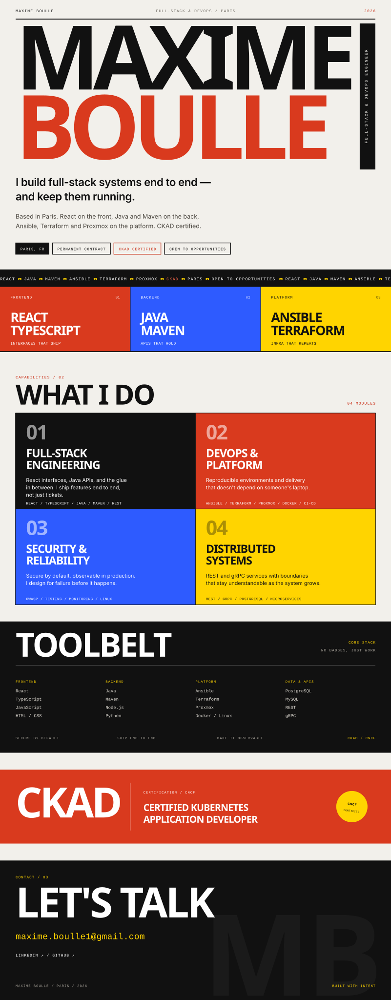

<picture>
  <source media="(max-width: 640px) and (prefers-color-scheme: dark)" srcset="assets/profile-mobile-dark.svg">
  <source media="(max-width: 640px)" srcset="assets/profile-mobile-light.svg">
  <source media="(prefers-color-scheme: dark)" srcset="assets/profile-dark.svg">
  <source media="(prefers-color-scheme: light)" srcset="assets/profile-light.svg">
  
</picture>

 

  

Plain-text version

### Maxime Boulle

**Full-Stack & DevOps Engineer** — Paris, France

I build full-stack systems end to end — and keep them running.

Based in Paris. React on the front, Java and Maven on the back, Ansible, Terraform and Proxmox on the platform. CKAD certified.

**Status** — Permanent contract · Open to opportunities **Certification** — CKAD, Certified Kubernetes Application Developer (CNCF)

**What I do**

- **Full-Stack Engineering** — React interfaces, Java APIs, and the glue in between. I ship features end to end, not just tickets.
- **DevOps & Platform** — Reproducible environments and delivery that doesn't depend on someone's laptop.
- **Security & Reliability** — Secure by default, observable in production. I design for failure before it happens.
- **Distributed Systems** — REST and gRPC services with boundaries that stay understandable as the system grows.

**Toolbelt**

- **Frontend** — React · TypeScript · JavaScript · HTML/CSS
- **Backend** — Java · Maven · Node.js · Python
- **Platform** — Ansible · Terraform · Proxmox · Docker · Linux
- **Data & APIs** — PostgreSQL · MySQL · REST · gRPC

**Contact** — [maxime.boulle1@gmail.com](mailto:maxime.boulle1@gmail.com) · [LinkedIn](https://linkedin.com/in/maxime-boulle-767a67221) · [GitHub](https://github.com/MaximeBoulle)

